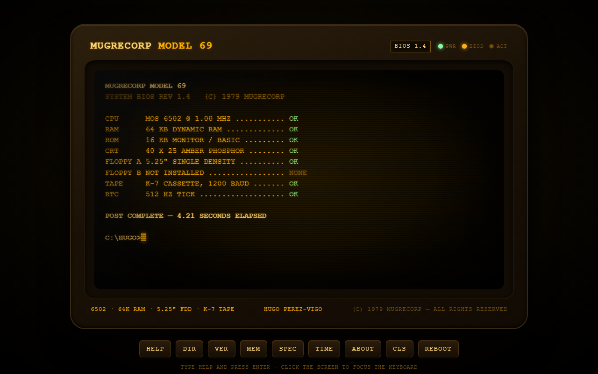

<meta property="og:title" content="MugreCorp MODEL 69">
<meta property="og:description" content="Un ordenador doméstico de 1979 en un único HTML: CRT de fósforo ámbar, POST y terminal con comandos retro.">
<meta property="og:image" content="https://raw.githubusercontent.com/Hugopvigo/BootSec/main/docs/capturas/og.webp">

<p align="center">
  
</p>

<p align="center">
  <b>Un ordenador doméstico de 1979 que cabe en un solo archivo.</b><br>
  CRT de fósforo ámbar, POST línea a línea y una terminal con comandos reales. Sin dependencias.
</p>

<p align="center">
  <a href="https://hugopvigo.github.io/BootSec/"></a>
  
  
  
  
  
</p>

---

## Qué es esto

**MugreCorp MODEL 69** es una recreación de un ordenador doméstico de 1979 en una sola página HTML. Todo el CSS y el JavaScript van en línea: **no hay fuentes, imágenes, librerías ni CDNs externos**. La máquina tiene carcasa redondeada, tres LEDs (dos encendidos y el de actividad parpadeando con cada tecla), placa BIOS, scanlines en modo `multiply`, bloom ámbar y viñeta de esquina.

> Proyecto de demostración. Es una recreación estética: el hardware y la BIOS son ficticios.

## Características

- **POST animado**: al cargar, la máquina escribe línea a línea la comprobación de CPU, RAM, ROM, CRT, dos unidades de disquete (una presente, otra `NONE`), cinta y RTC, y termina con `POST COMPLETE — 4.21 SECONDS ELAPSED`.
- **Terminal de verdad**: prompt `C:\HUGO>` con cursor de bloque parpadeante, eco carácter a carácter, retroceso, historial con las flechas arriba/abajo y ejecución con Enter.
- **Nueve comandos**: `help`, `dir`, `ver`, `mem`, `spec`, `time`, `about`, `cls` y `reboot` (que limpia la pantalla y vuelve a reproducir el POST). Los comandos desconocidos devuelven un error en rojo.
- **Botones de acceso rápido**: una fila de teclas bajo la pantalla ejecuta cualquier comando con un clic.
- **Paleta fija**: ámbar `#ffb000` sobre casi negro `#0a0700`, verde para los `OK`, ámbar pálido para cabeceras, rojo para errores y marrón apagado para el chrome inactivo. Todo en Courier New.
- **Responsive**: la pantalla ocupa todo el ancho, la carcasa y los paddings se reducen en móvil y la fila de botones se ajusta en varias líneas.
- **Accesibilidad y motion**: botones reales con foco visible, `aria-live` implícito en la salida, scrollbar y selección tematizados y respeto a `prefers-reduced-motion`.

## Uso

Abre `index.html` directamente en cualquier navegador moderno. No necesita servidor ni instalación.

Si prefieres servirlo localmente:

```bash
python -m http.server 8000
```

y visita `http://localhost:8000/`. La demostración publicada está en [hugopvigo.github.io/BootSec](https://hugopvigo.github.io/BootSec/).

## Comandos

| Comando | Qué hace |
|---|---|
| `help` | Lista los comandos disponibles |
| `dir` | Muestra el directorio de la unidad A: |
| `ver` | Versión del DOS y de la BIOS |
| `mem` | Mapa de memoria y uso de RAM |
| `spec` | Especificaciones del hardware |
| `time` | Hora y fecha actuales |
| `about` | Sobre la máquina |
| `cls` | Limpia la pantalla |
| `reboot` | Reinicia y vuelve a ejecutar el POST |

## Licencia

[Creative Commons Attribution-NonCommercial-ShareAlike 4.0 International](https://creativecommons.org/licenses/by-nc-sa/4.0/). Puedes compartir y adaptar el proyecto con fines no comerciales, citando al autor y distribuyendo las obras derivadas bajo la misma licencia.

Desarrollado por **Hugo Perez-Vigo** · Noviembre de 2025.
